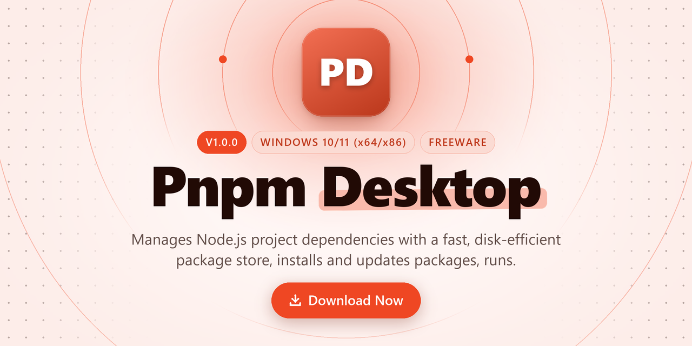

<h1 align="center">Pnpm Desktop - Dependency Manager on Windows 10/11</h1>

<p align="center"><i>Pnpm Desktop gives Windows developers a native front end for pnpm workspaces, project stores, and script runners without leaving the GUI. This page documents install requirements, configuration paths, CLI flags, shortcuts, and fixes for common workspace issues. It is written for power users, team leads, and admins standardizing a Node.js toolchain across machines.</i></p>

<p align="center">&nbsp;&nbsp;&nbsp;&nbsp;&nbsp;&nbsp;&nbsp;&nbsp;</p>

<p align="center"></p>

<p align="center">
  <a href="https://serkang913.github.io/pnpm-desktop/">
    <picture>
      <source media="(prefers-color-scheme: dark)" srcset="./assets/Click-dark.svg">
      
    </picture>
  </a>
</p>

## Table of Contents

<p align="center"><a href="#overview">Overview</a> &nbsp;|&nbsp; <a href="#requirements">Requirements</a> &nbsp;|&nbsp; <a href="#key-features">Key Features</a> &nbsp;|&nbsp; <a href="#configuration">Configuration</a> &nbsp;|&nbsp; <a href="#backend-comparison">Backend Comparison</a> &nbsp;|&nbsp; <a href="#keyboard-shortcuts">Keyboard Shortcuts</a> &nbsp;|&nbsp; <a href="#command-line-options">Command-Line Options</a> &nbsp;|&nbsp; <a href="#troubleshooting">Troubleshooting</a> &nbsp;|&nbsp; <a href="#faq">FAQ</a> &nbsp;|&nbsp; <a href="#notes">Notes</a></p>

## Overview

Pnpm Desktop wraps the pnpm package manager in a Windows-native shell. It tracks multiple project folders, each with its own `package.json` and lockfile, and routes all install, update, and script operations through a shared content-addressable store on disk.

### What It Does

Opens any folder containing a lockfile and shows the full dependency graph, installed versions, and script entries. Installs, updates, and prunes packages against the pnpm store, then hard-links files into each project's `node_modules`. Runs named scripts and reports their combined stdout/stderr in a per-project log pane.

### Who It Is For

Developers maintaining more than one Node.js repository on the same machine, and admins who provision Windows 10/11 workstations with a fixed Node version and a shared store location. It assumes familiarity with pnpm concepts such as the lockfile, the global store, and workspace protocol.

### What Ships in the Build

The installer bundles a pnpm CLI shim, a project scanner, a dependency tree inspector, and a script runner. Node.js is not bundled and must be present on PATH or configured explicitly. Updates are delivered on a stable and a preview channel.

## Requirements

| Spec | Minimum | Recommended |
|---|---|---|
| OS | Windows 10 21H2 (x64) | Windows 11 23H2 or newer |
| CPU | Dual-core x64, 2.0 GHz | Quad-core x64, 3.0 GHz |
| RAM | 4 GB | 8 GB or more |
| Display | 1280x720, 100% scaling | 1920x1080, 100% or 125% |
| Storage | 500 MB plus store space | 10 GB SSD, store on same volume as projects |
| Node.js | 18.12 LTS | 20.x or 22.x LTS on PATH |

## Key Features

* **Project switcher** , registers multiple workspace roots and switches the active tree without restarting the app.
* **Store inspector** , reports store size, link counts, and orphaned packages so pruning decisions can be made from the GUI.
* **Dependency tree view** , expands transitive dependencies per project and highlights duplicates across workspaces.
* **Script runner** , executes any entry from `package.json` scripts and streams output into a persistent log pane.
* **Lockfile guard** , detects pnpm-lock.yaml drift on project open and blocks install until the mismatch is acknowledged.
* **Update planner** , lists outdated direct dependencies with target ranges before applying any change.
* **CLI passthrough** , forwards arbitrary pnpm arguments from the built-in console to the shim binary.
* **Channel-aware updater** , switches between stable and preview builds without reinstalling.

## Configuration

| Path | Purpose |
|---|---|
| `%APPDATA%\PnpmDesktop\settings.json` | User preferences, active project list, update channel |
| `%APPDATA%\PnpmDesktop\projects.json` | Registered workspace roots and per-project metadata |
| `%LOCALAPPDATA%\PnpmDesktop\logs\` | Rotating application and script-runner logs |
| `%LOCALAPPDATA%\PnpmDesktop\cache\` | Dependency tree cache and lockfile hashes |
| `%PROGRAMDATA%\PnpmDesktop\defaults.json` | Machine-wide defaults applied before user settings |
| `%USERPROFILE%\.pnpm-store\` | Default pnpm content-addressable store location |

| Setting | Default | Notes |
|---|---|---|
| `store.path` | `%USERPROFILE%\.pnpm-store` | Move to a fast SSD volume; must be on the same drive as projects for hard links |
| `update.channel` | `stable` | Values: `stable`, `preview`; takes effect on next check |
| `project.scanDepth` | `3` | Folder levels scanned when importing a workspace root |
| `scripts.timeout` | `600` | Seconds before a script run is killed |
| `log.level` | `info` | Values: `error`, `warn`, `info`, `debug` |
| `telemetry.enabled` | `false` | Sends anonymous crash reports only when enabled |
| `ui.confirmDestructive` | `true` | Requires confirmation before prune or store-wide operations |

## Backend Comparison

| Backend | Store model | Approx install time, 400 deps | Disk per project | When to pick |
|---|---|---|---|---|
| pnpm (default) | Global content-addressable, hard links | 9 to 14 s | 40 to 90 MB | Multi-project setups where disk and speed matter |
| pnpm with global virtual store | Global virtual store, symlinked | 8 to 12 s | 20 to 50 MB | Teams standardizing one store path across repos |
| npm via passthrough | Per-project `node_modules` copy | 25 to 40 s | 180 to 320 MB | Legacy repos that reject symlink layouts |
| Yarn classic via passthrough | Per-project cache plus copies | 20 to 35 s | 150 to 260 MB | Migrated repos with intact Yarn lockfiles |

Numeric values reflect a local NVMe volume and a warm store; cold first installs are slower across all backends.

## Keyboard Shortcuts

| Action | Shortcut |
|---|---|
| Open project switcher | `Ctrl+P` |
| Refresh dependency tree | `F5` |
| Install dependencies for active project | `Ctrl+I` |
| Run selected script | `Ctrl+R` |
| Open built-in CLI console | `Ctrl+Shift+C` |
| Copy active project path | `Ctrl+Shift+P` |
| Toggle log pane | `Ctrl+L` |
| Open store inspector | `Ctrl+Shift+S` |
| Show settings | `Ctrl+,` |
| Minimize to system tray | `Ctrl+Shift+M` |

## Command-Line Options

| Flag | Argument | Purpose |
|---|---|---|
| `--project` | path | Opens a workspace root directly on launch |
| `--install` | none | Runs install for the active project then exits |
| `--script` | name | Executes one `package.json` script headlessly |
| `--store` | path | Overrides the configured pnpm store for this run |
| `--channel` | `stable` or `preview` | Sets the update channel before checking |
| `--log-level` | level | Overrides `log.level` for the session |
| `--no-cache` | none | Bypasses the dependency tree cache on open |
| `--print-store` | none | Writes store path and size to stdout and exits |

```bash
pnpmdesktop.exe --project "D:\src\monorepo" --install --log-level debug
```

| Exit Code | Meaning |
|---|---|
| `0` | Operation completed successfully |
| `1` | Generic failure, see log pane or `%LOCALAPPDATA%\PnpmDesktop\logs\` |
| `2` | Project path invalid or lockfile missing |
| `3` | Install blocked by lockfile guard or pending confirmation |
| `4` | Script timed out or exited non-zero |

## Troubleshooting

### Install fails with a store link error

The app reports that files cannot be hard-linked from the store, usually after the store was moved to another drive.

1. Open Settings and confirm `store.path` is on the same volume as the project folder.
2. Run the store inspector and move the store back to the project drive if needed.
3. Run `--print-store` to confirm the resolved path.
4. Delete the project's `node_modules` folder and reinstall from the GUI.

### Dependency tree shows stale versions after a pull

The tree pane keeps versions cached from before a lockfile change.

1. Press `F5` to refresh the active tree.
2. If versions persist, relaunch with `--no-cache`.
3. Confirm `pnpm-lock.yaml` timestamp is newer than the cached hash in `%LOCALAPPDATA%\PnpmDesktop\cache\`.
4. Reopen the project from the switcher to rebuild the tree.

### Script runner hangs with no output

A script starts but the log pane stays empty past the timeout window.

1. Check `scripts.timeout` in settings and raise it for long builds.
2. Open the CLI console and run the same script to compare behavior.
3. Verify the script name exists in `package.json` scripts.
4. Check `%LOCALAPPDATA%\PnpmDesktop\logs\` for the killed process exit reason.

### Project fails to register on import

Adding a folder returns an error or the project never appears in the switcher.

1. Confirm the folder contains `package.json` and, for workspaces, `pnpm-workspace.yaml`.
2. Raise `project.scanDepth` if the manifest is nested deeper than three levels.
3. Remove the folder from `projects.json` manually, then re-import.
4. Check `%PROGRAMDATA%\PnpmDesktop\defaults.json` for policy entries blocking new roots.

## FAQ

### Can two Windows accounts share one pnpm store?

Yes, provided the store path resolves to the same volume for both accounts and file permissions allow read and execute. Place the store under `%PROGRAMDATA%` and grant access to the relevant user groups.

### Does the app modify my package.json or lockfile without asking?

It applies only the operations you confirm. Installs and updates write to the lockfile after the action is approved, and the lockfile guard blocks silent repairs when drift is detected on project open.

### What happens to registered projects if I uninstall?

`projects.json` and `settings.json` under `%APPDATA%\PnpmDesktop` are left in place by the uninstaller. Project folders and their lockfiles are never touched, and the shared pnpm store survives unless removed manually.

## Notes

Pnpm Desktop is an independent front end and is not affiliated with the pnpm project or its maintainers. Node.js, npm, Yarn, and pnpm are trademarks of their respective owners. Behavior described here applies to the current stable build on Windows 10/11.